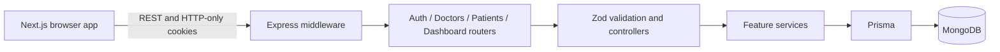
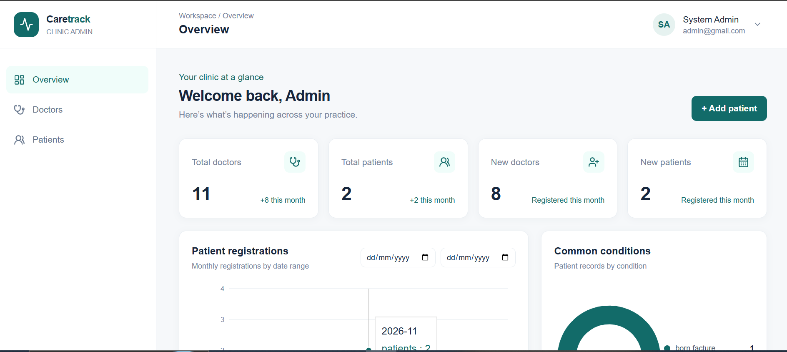
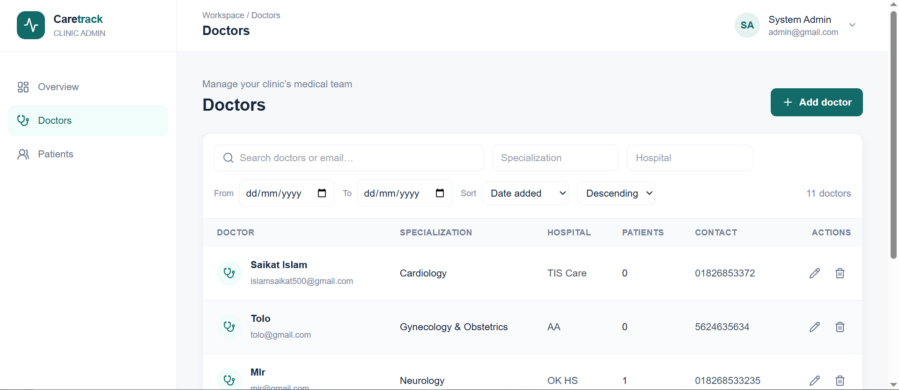
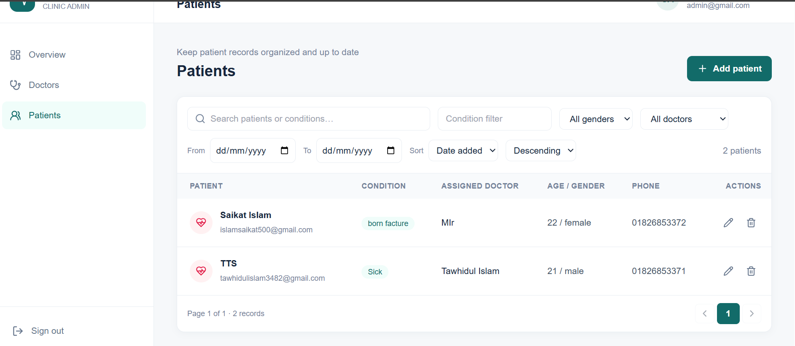
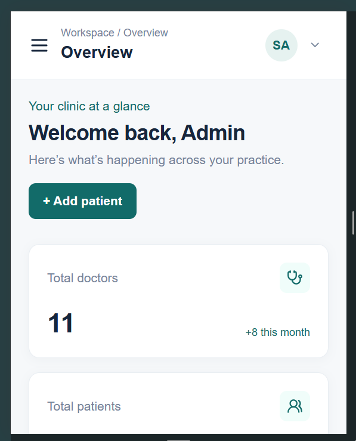
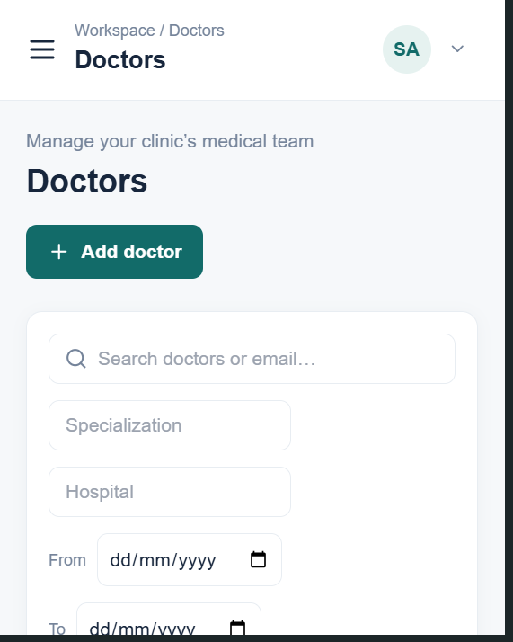
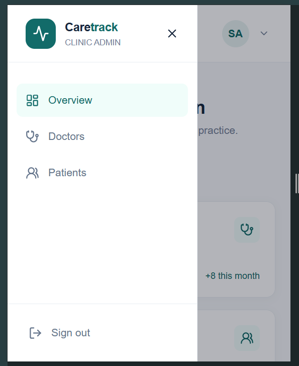
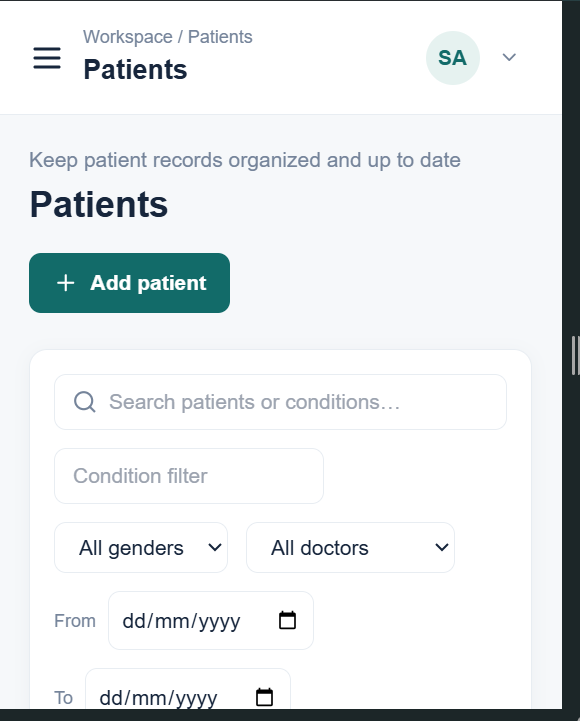

# Doctor Tracker API

## Description

Doctor Tracker API is the secure data and authentication service for a clinic administration app. It provides validated endpoints for administrator sessions, doctor and patient records, and dashboard analytics, backed by MongoDB through Prisma.

## Setup guide

### Requirements

- Node.js 20 or newer
- MongoDB connection string (MongoDB replica set recommended for Prisma transaction support)

### Install and run locally

1. Install dependencies:

   ```sh
   npm install
   ```

2. Copy `.env.example` to `.env` (`Copy-Item .env.example .env` in PowerShell).
3. Set `DATABASE_URL`, `CLIENT_ORIGIN`, independent JWT secrets, and the initial administrator name, email, and password in `.env`. Generate strong secrets with:

   ```sh
   node -e "console.log(require('crypto').randomBytes(32).toString('hex'))"
   ```

4. Generate Prisma Client, apply the schema, and start the API:

   ```sh
   npm run db:generate
   npm run db:push
   npm run dev
   ```

The API listens at `http://localhost:4000`. On startup it connects to MongoDB and creates the initial administrator only if no admin exists. There is no public registration endpoint. `.env.example` lists every supported environment variable; replace all example secrets and credentials for real deployments.

### Environment variables

| Variable | Description |
| --- | --- |
| `PORT` | API port, default `4000` |
| `DATABASE_URL` | MongoDB connection string |
| `CLIENT_ORIGIN` | Exact frontend origin allowed by CORS |
| `JWT_ACCESS_SECRET` | Access token signing secret, 32+ characters |
| `JWT_REFRESH_SECRET` | Separate refresh token signing secret, 32+ characters |
| `ACCESS_TOKEN_TTL` | Access token lifetime, default `15m` |
| `REFRESH_TOKEN_TTL` | Refresh token lifetime, default `7d` |
| `ADMIN_NAME` | Initial administrator name |
| `ADMIN_EMAIL` | Initial administrator email |
| `ADMIN_PASSWORD` | Initial administrator password, at least 12 characters |

## System architecture

The Next.js frontend makes credentialed requests to the Express API. Security headers, rate limiting, origin checks, JSON limits, and cookie parsing run before feature routers. Each router sends validated input to a controller, then to a service that performs database work through Prisma. At startup, Prisma connects before the one-time administrator bootstrap runs and the API begins accepting requests.



Feature modules are organized in `src/modules/`; shared middleware, database configuration, response helpers, and error handling live in `src/middleware`, `src/config`, and `src/utils`.

## Technical decisions

1. **Feature modules with schema validation at the API boundary.** Routes, controllers, services, and Zod schemas live together for auth, doctors, patients, and dashboard features. Controllers validate request data before services run, which keeps HTTP handling separate from business and database logic. The structure adds a few files per feature but makes changes and validation rules easier to locate.
2. **Prisma with MongoDB and HTTP-only JWT cookies.** Prisma provides typed queries and the schema declares indexes for common doctor, condition, gender, and creation-date queries. Dashboard summaries use database aggregates rather than loading every record. Short-lived access and refresh JWTs stay in HTTP-only cookies; origin checks protect state-changing requests. MongoDB must be reachable and Prisma Client generated before startup.

## Visual evidence

These captures show the frontend workflows backed by this API. The original UI captures are also maintained in the frontend repository.

### Desktop

| Dashboard | Doctors |
| --- | --- |
|  |  |



### Mobile

| Dashboard | Doctors |
| --- | --- |
|  |  |





## API

All routes are prefixed with `/api/v1`. Authentication endpoints are `/auth/login`, `/auth/refresh`, `/auth/logout`, and `/auth/me`. Protected resources include `/doctors`, `/patients`, and `/dashboard/overview`, `/dashboard/patient-trends`, `/dashboard/doctor-statistics`, and `/dashboard/condition-statistics`.

The API uses HTTP-only cookies and checks browser `Origin` on state-changing requests. Cookies use `SameSite=Lax` in development and `SameSite=None; Secure` in production so separately hosted frontend and backend origins can authenticate. In production, use HTTPS, separate strong signing keys, restrict MongoDB network access, and set `CLIENT_ORIGIN` to the exact frontend origin.

## Scripts

| Command | Action |
| --- | --- |
| `npm run dev` | Start the API in watch mode |
| `npm run build` | Compile TypeScript to `dist/` |
| `npm start` | Run the compiled API |
| `npm run db:generate` | Generate Prisma Client |
| `npm run db:push` | Apply the Prisma schema to MongoDB |
| `npm run seed` | Create the configured admin only when no admin exists |
| `npm test` | Run admin bootstrap, auth, and request validation tests |
